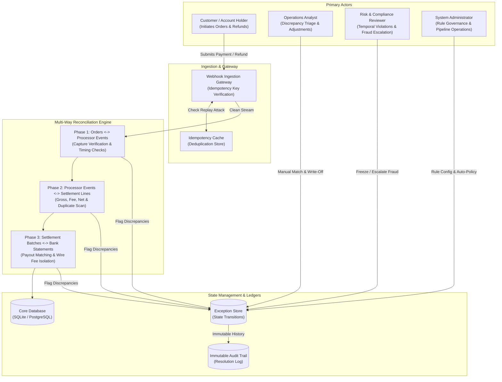
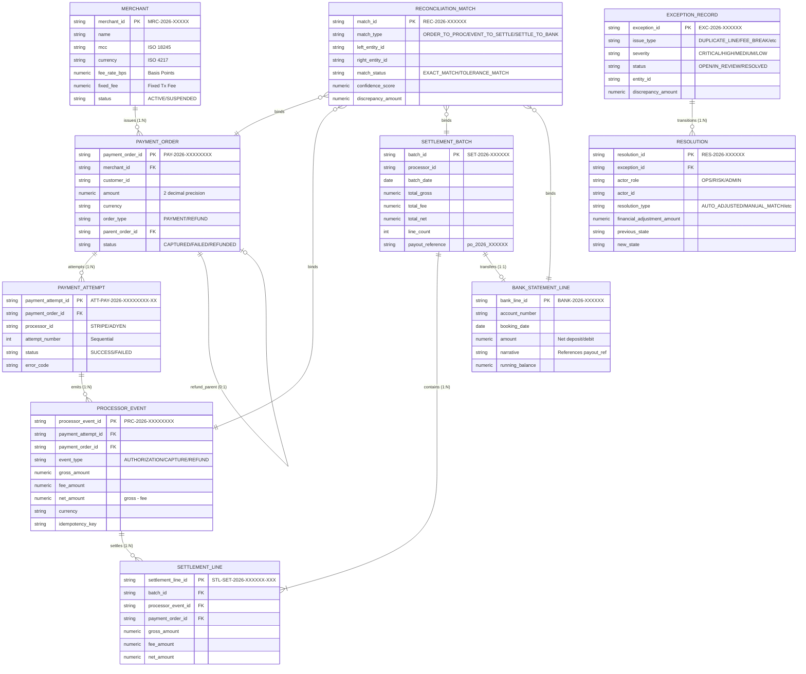
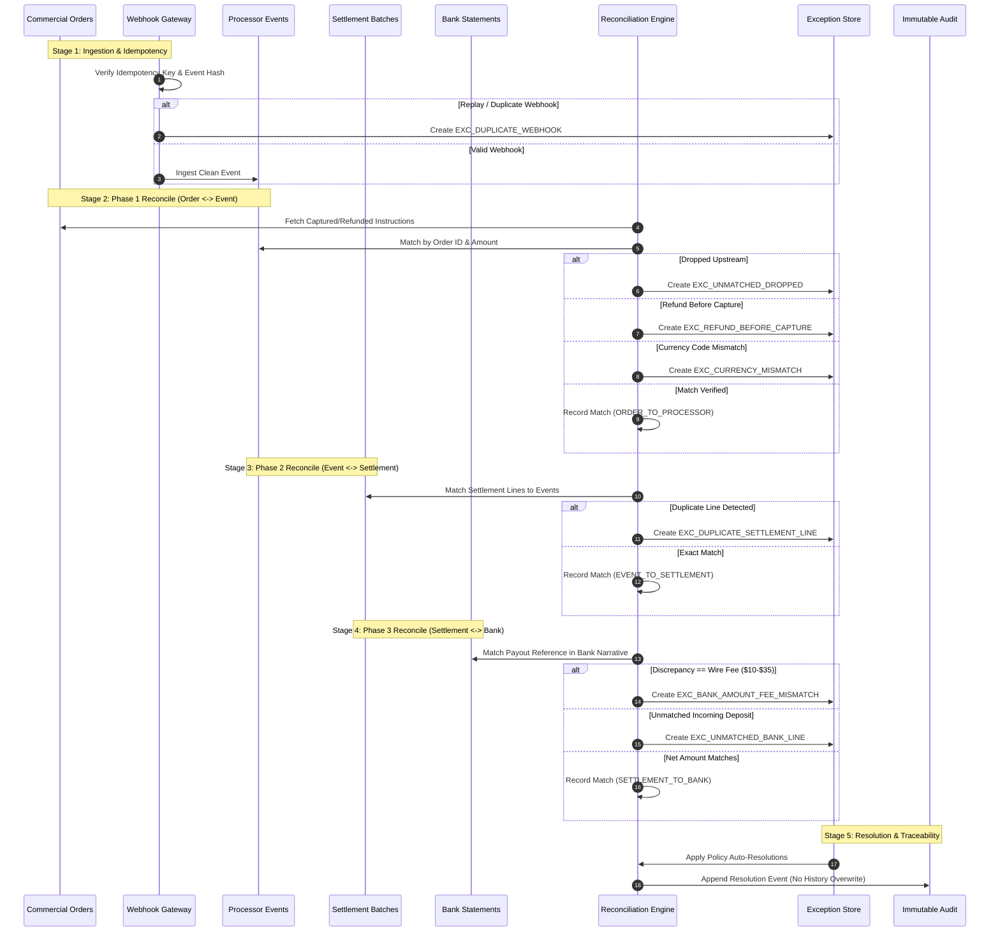

# YottaFlex.ai Payment Reconciliation Platform — System Architecture & Design Specification

## 1. Executive Summary

The **YottaFlex Payment Reconciliation Platform** is an enterprise-grade financial engineering system designed to reconcile commercial payment instructions, asynchronous payment gateway processor events, processor settlement clearing batches, and treasury commercial bank statement lines.

The platform provides:
1. **Multi-Way Invariant Matching**: Cross-entity deterministic binding across Commercial Instructions ($Order$), Gateway Events ($ProcessorEvent$), Payout Batches ($SettlementBatch$), and Cash Movements ($BankStatementLine$).
2. **Idempotency Gateway**: Strict at-most-once webhook processing semantics to neutralize duplicate deliveries without mutating or corrupting accounting ledgers.
3. **Automated Anomaly Detection & Exception Isolation**: Detection of duplicate lines, unannounced fee breaks, temporal lifecycle inversions (refund before capture), silent upstream drops, currency mismatches, and orphan treasury deposits.
4. **Role-Based Exception Governance & Resolution Engine**: Workspaces for Operations Analysts, Risk & Compliance Officers, and System Administrators, backed by an append-only immutable audit ledger.
5. **Segregated Ground Truth & Benchmarking**: Pure zero-leakage evaluation measuring Precision, Recall, F1-Score, and Financial Discrepancy Reconciliation.

---

## 2. Actors & System Boundaries

---

## 3. Entity-Relationship Model & Cardinality

The system models 10 core entities with strict referential integrity, standardized zero-padded ID nomenclatures, and validated primary/foreign key joins.

---

## 4. Multi-Way Reconciliation Pipeline Workflow

The reconciliation pipeline operates in three sequential deterministic phases:

---

## 5. Architectural Invariants & Guarantees

1. **Idempotent Ingestion**: Raw webhook deliveries cannot cause double accounting. Duplicate payloads with identical idempotency keys or transaction references are immediately filtered into an exception quarantine.
2. **Arithmetic Conservation**:
   $$\text{Line Net} = \text{Line Gross} - \text{Line Fee}$$
   $$\text{Batch Net} = \sum \text{Line Net}$$
   $$\text{Bank Running Balance}_i = \text{Bank Running Balance}_{i-1} + \text{Deposit Amount}_i$$
3. **Temporal Lifecycle Validity**:
   $$\text{Order Created} \le \text{Attempt Created} \le \text{Event Timestamp} \le \text{Settlement Date} \le \text{Bank Booking Date}$$
   For refunds, the parent payment capture must strictly precede the refund issuance. Inversions are flagged as Critical/High priority compliance anomalies.
4. **Segregated Ground Truth**:
   The engine evaluates raw transactional data purely through domain rules. Ground-truth labels are stored in isolated catalogs (`ground_truth.csv` and `ground_truth.json`) and are never exposed to the matcher.
5. **Immutable History**:
   State transitions are recorded as append-only `Resolution` events linked to `ExceptionRecord`. Historical state is preserved for SOC 1/2 and SOX compliance.
